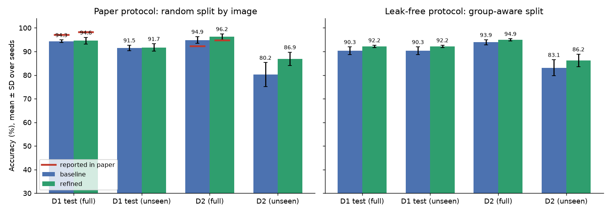
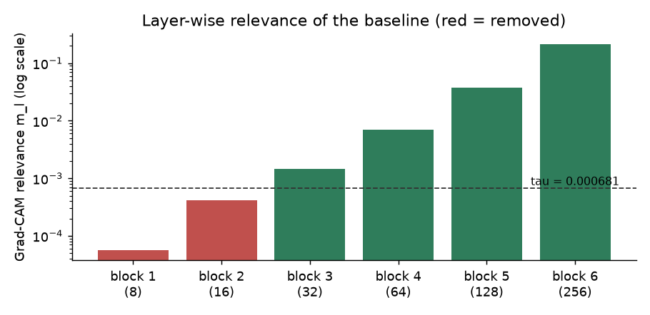
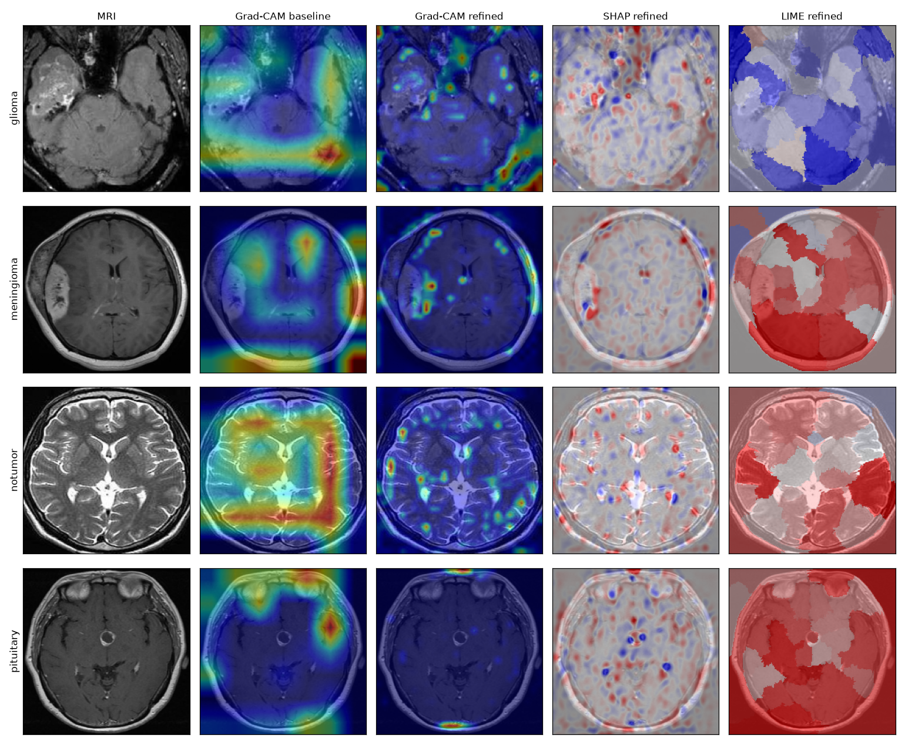

<div align="center">

# From Explanations to Architecture: Explainability-Driven CNN Refinement for Brain Tumor Classification in MRI

[Rajan Das Gupta](https://rajandasguptaml.github.io/)<sup>1</sup> · Md Imrul Hasan Showmick<sup>2</sup> · Lei Wei<sup>3,†</sup> · Mushfiqur Rahman Abir<sup>1</sup> · Shanjida Akter<sup>4</sup> · Md. Yeasin Rahat<sup>1</sup> · Md. Jakir Hossen<sup>5</sup>

<sup>1</sup>American International University-Bangladesh · <sup>2</sup>Brac University · <sup>3</sup>Shinawatra University · <sup>4</sup>North South University · <sup>5</sup>Multimedia University
<sup>†</sup>Corresponding author

**BIC 2026** · 6th International Conference on Bioinformatics and Intelligent Computing · ACM, pp. 853–860

[](https://doi.org/10.1145/3809986.3810119)
[](https://arxiv.org/abs/2506.09161)
[](https://rajandasguptaml.github.io/xai-cnn-refinement/)
[](https://github.com/rajandasguptaml/xai-cnn-refinement/actions/workflows/ci.yml)
[](LICENSE)



</div>

## Overview

Explainability is usually applied after training, to draw heatmaps. This work uses it to change the model: Grad-CAM
relevance is measured for every convolutional block of a small CNN, the least relevant blocks are removed, and the
network is retrained. SHAP and LIME then check that the refined model attends to tumor tissue.

This repository is a PyTorch implementation of the full method, run on the paper's protocol **and** on a leak-free
protocol. The two Kaggle datasets used in the paper overlap heavily: Dataset-2 (SARTAJ) is largely contained in
Dataset-1 (Msoud), and each contains near-duplicate images within itself. A
[duplicate audit](https://www.kaggle.com/datasets/rajandasguptaml/brain-tumor-mri-duplicate-and-leakage-audit) of all
10,464 images supplies the leak-free splits; see the [data card](data/README.md).

## Results

- **Refinement adds about 0.2 points on the paper's protocol.** Dataset-1 test accuracy goes from 94.3% to 94.6% (mean of 3 seeds); the paper reports 97.10% to 98.21% with its TensorFlow implementation.
- **Duplicates inflate the cross-dataset score.** On all of Dataset-2 the refined model scores 96.2%; on the 653 Dataset-2 images that have no copy in the training data it scores 86.9% ± 2.8, about 9 points lower.
- **On those unseen images, refinement helps most:** 80.2% ± 5.1 for the baseline against 86.9% ± 2.8 for the refined model (macro F1 77.3 against 81.9). This subset is mostly glioma, so macro F1 is the fairer summary.
- **On the leak-free protocol** (group-aware split; no duplicate straddles train and test), Dataset-1 accuracy is 90.3% for the baseline and 92.2% for the refined model.
- Unseen Dataset-2 images under the leak-free protocol (787): 83.1% baseline and 86.2% refined (macro F1 80.8 and 83.7).
- **The refined model is not lighter.** Grad-CAM relevance (Eq. 4) grows with depth in every run, so the rule removes the earliest blocks (kept blocks: [2, 3, 4, 5]). Parameters go from 790,356 to 785,220, and because the first remaining layer runs at full resolution, the refined model is several times slower to train and to run (timings on our shared machine are only indicative). The paper's own timings (10 ms to 11 ms per image) point the same way.

Accuracy (%), mean ± SD over seeds 0, 1, 2; "unseen" excludes every test image with a duplicate in
the training or validation partition:

| Protocol | Model | D1 test, full | D1 test, unseen | D2, full | D2, unseen |
|---|---|---|---|---|---|
| paper | baseline | 94.3 ± 0.6 | 91.5 ± 1.1 | 94.9 ± 1.4 | 80.2 ± 5.1 |
| paper | refined | 94.6 ± 1.4 | 91.7 ± 1.6 | 96.2 ± 1.2 | 86.9 ± 2.8 |
| clean | baseline | 90.3 ± 1.6 | 90.3 ± 1.6 | 93.9 ± 1.1 | 83.1 ± 3.4 |
| clean | refined | 92.2 ± 0.5 | 92.2 ± 0.5 | 94.9 ± 0.5 | 86.2 ± 2.6 |

- `paper` protocol: D1 test 699 images, of which 367 unseen; D2 3264 images, of which 653 unseen.
- `clean` protocol: D1 test 705 images, of which 705 unseen; D2 3264 images, of which 787 unseen.

Per-run metrics (accuracy, macro precision, recall, F1 and confusion matrices) are in
[results/results.json](results/results.json); the per-seed relevance charts and explanation panels are in the
`results/<protocol>_seed<k>/` folders.

<p align="center"></p>
<p align="center"></p>

In these four unseen examples the refined model's Grad-CAM maps are sparser than the baseline's, but they do not
consistently move onto the tumor, and SHAP and LIME spread attribution over large parts of the slice. A quantitative
check of explanation quality (deletion and insertion curves) is on the [roadmap](ROADMAP.md).

## Method

1. **Preprocessing** (Sec. 3.2): grayscale, threshold, erosion and dilation, crop to the largest contour's extreme
   points, rescale intensities, resize to 224 x 224.
2. **Baseline CNN** (3.3): six Conv(3x3) + ReLU + MaxPool blocks with 8, 16, 32, 64, 128, 256 filters, batch
   normalisation, global average pooling, two 512-unit layers, 4-way output. Adam, lr 1e-3, batch 40, 40 epochs.
3. **Layer-wise relevance** (3.4, Eq. 4): m_l = mean Grad-CAM intensity of block l, averaged over the validation set.
4. **Refinement** (3.5): tau = 25th percentile of m_l; blocks with m_l < tau are removed and the network is retrained
   with the same protocol.
5. **Validation** (3.6): Grad-CAM of both models, SHAP (GradientExplainer) and LIME on the refined model.

## Quick start

```bash
git clone https://github.com/rajandasguptaml/xai-cnn-refinement.git && cd xai-cnn-refinement
pip install -r requirements.txt            # install a CUDA build of PyTorch first if you have a GPU
# download the two Kaggle datasets into data/images/ as described in data/README.md
python scripts/run_experiments.py --config configs/default.yaml                  # both protocols, 3 seeds
python scripts/make_figures.py --results results                                 # tables and figures
python scripts/run_experiments.py --protocols clean --seeds 0 --epochs 2 --out outputs/smoke   # 5-minute smoke run
pytest -q
```

A run of one protocol and one seed (baseline and refined model) takes roughly 25 minutes on an RTX 2050 (4 GB).

## Repository layout

```
xai-cnn-refinement/
├── xairefine/          preprocess, data (both protocols, unseen sets), model, gradcam, refine, train, metrics, explain
├── scripts/            run_experiments.py, make_figures.py
├── configs/            default.yaml
├── data/               image_index.csv (duplicate groups and clean split) and the data card
├── results/            results.json, summary.md, figures, per-seed relevance charts and explanation panels
├── tests/              unit tests
├── paper/              arXiv PDF and BibTeX
└── docs/               project page
```

## Differences from the paper

- PyTorch instead of TensorFlow; global average pooling before the dense layers.
- The checkpoint with the best validation accuracy is kept.
- The 203 `*aug*` files added to the Msoud dataset after the paper are excluded (6,997 images instead of 7,023).
- Results are averaged over 3 seeds, and every number is reported on the full and the unseen test sets.

## Citation

```bibtex
@inproceedings{dasgupta2026explanations,
  title     = {From Explanations to Architecture: Explainability-Driven {CNN} Refinement for Brain Tumor Classification in {MRI}},
  author    = {Das Gupta, Rajan and Showmick, Md Imrul Hasan and Wei, Lei and Abir, Mushfiqur Rahman and Akter, Shanjida and Rahat, Md. Yeasin and Hossen, Md. Jakir},
  booktitle = {Proceedings of the 2026 6th International Conference on Bioinformatics and Intelligent Computing (BIC 2026)},
  publisher = {ACM},
  year      = {2026},
  pages     = {853--860},
  doi       = {10.1145/3809986.3810119},
  url       = {https://arxiv.org/abs/2506.09161}
}
```

## License

Code is released under the [MIT License](LICENSE). The image datasets are not redistributed; see the data card for
their licences.
